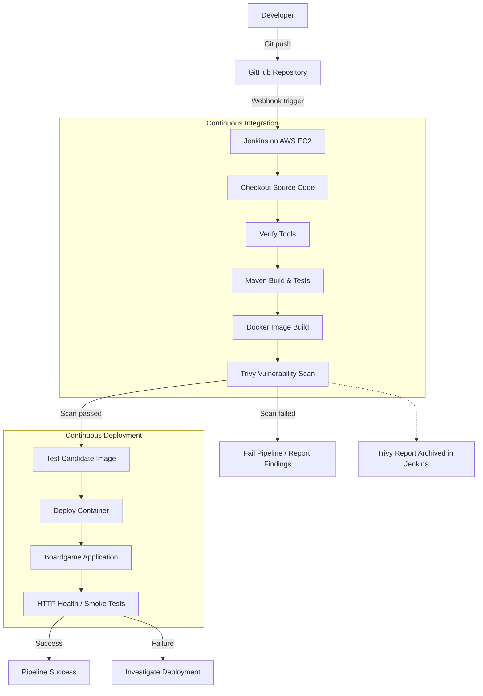

# Boardgame CI/CD Pipeline — Jenkins, Docker & Trivy

## Project Overview
This project demonstrates a CI/CD pipeline for a Java Spring Boot Boardgame application using Jenkins, Docker, GitHub, Maven, and Trivy.

## Technology Stack
- Java 17 and Spring Boot 4
- Git and GitHub
- Jenkins Pipeline
- Maven
- Docker
- Trivy
- Ubuntu on AWS EC2

## Pipeline Flow
GitHub → Webhook → Jenkins → Maven Tests → Docker Build → Trivy Scan → Test Deployment → Validation

## Pipeline Stages
1. Checkout source code from GitHub.
2. Verify required tools.
3. Build the application and run Maven tests.
4. Build the Docker image.
5. Scan the image using Trivy and archive the report.
6. Prepare the test candidate.
7. Deploy the container to the test environment.
8. Report the pipeline result.

## Security and Validation
- Configured a GitHub webhook for push-triggered builds.
- Used a multi-stage Docker build and a Java 17 runtime image.
- Applied an Alpine package security update.
- Generated a Trivy vulnerability report.
- Verified the application homepage returned HTTP 200.
- Verified unauthenticated requests to `/secured` and `/manager/` returned HTTP 302 redirects.
- Confirmed the Docker container was running.

The Jenkins pipeline completed successfully. These smoke tests are basic validation, not a complete security audit.

## Repository Details
- Repository: `Rajesh-210/Boardgame`
- Branch: `security/boot4-migration`
- Jenkins job: `Boardgame-CI`

## Skills Demonstrated
Git, GitHub webhooks, Jenkins CI/CD, Maven, Docker, Trivy, application smoke testing, AWS EC2, and security-group configuration.

## Future Improvements
- Define vulnerability thresholds for the pipeline.
- Improve review authorization and deletion security.
- Configure persistent database storage.
- Add health checks and rollback procedures.
- Extend infrastructure with Terraform and optionally Kubernetes.

## Conclusion
This project demonstrates automated testing, containerization, vulnerability scanning, and test deployment in a practical DevOps workflow.

## 10. Architecture Diagram

The following diagram illustrates the CI/CD workflow from source-code changes through testing, image security scanning, and deployment.

